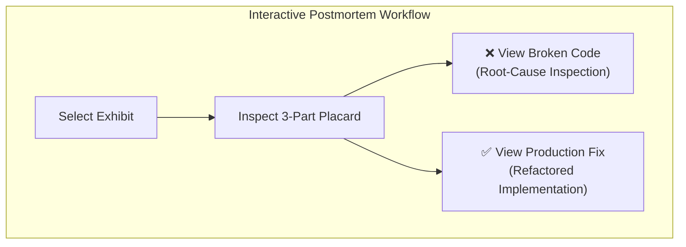
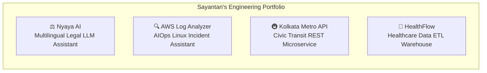

# ⚡ Sayantan Ghosh — Cloud, Backend & Applied AI Portfolio
> **Backend, AI & Cloud Engineer** | MCA '27 • Techno International Newtown (MAKAUT, Kolkata)  
> *Production-minded systems, validated REST APIs, LLM document pipelines, and real-world engineering postmortems.*

[](https://aws.amazon.com/amplify/)
[](https://fastapi.tiangolo.com/)
[](https://www.python.org/)
[](https://www.postgresql.org/)
[](https://github.com/Sayantan-da)
[](https://linkedin.com/in/sayantan-ghosh-aa9500335)

---

## 🏗️ Architecture & Deployment Flow

```mermaid
flowchart LR
    subgraph Dev["1. Source Control"]
        A[Git Push to 'main'] --> B[GitHub: Sayantan-da]
    end

    subgraph CI["2. AWS Amplify CI/CD"]
        B -->|Webhook Trigger| C[Amplify Build Agent]
        C -->|Validates Linux Paths| D[amplify.yml<br/>baseDirectory: /]
    end

    subgraph AWS["3. AWS Managed Infrastructure"]
        D -->|Immutable Sync| E[(Amazon S3<br/>Origin Bucket)]
        E -->|Secure TLS 1.3 Origin| F[Amazon CloudFront<br/>Global Edge CDN]
    end

    subgraph Client["4. Recruiter / Client Access"]
        F -->|Brotli / HTTPS Cache| G[Client Browser<br/>Sub-second load]
    end

    classDef aws fill:#FF9900,stroke:#232F3E,stroke-width:2px,color:#232F3E;
    classDef git fill:#24292e,stroke:#ffffff,stroke-width:1px,color:#ffffff;
    classDef edge fill:#0284c7,stroke:#0369a1,stroke-width:2px,color:#ffffff;
    class D,E aws;
    class A,B git;
    class F,G edge;
```



### Why Zero-Build on AWS Amplify?
- **Speed**: Build and deploy takes under 60 seconds with zero compiler overhead.
- **Reliability**: No Node/npm packaging vulnerabilities or runtime drift.
- **Cost & Scaling**: 100% serverless static assets served through CloudFront edge caches with virtually zero compute costs.

---

## 🏛️ Star Feature: "The Museum of My Mistakes"

> *"Finished project links only show what worked on the tenth try — documenting the bugs that broke my first nine attempts demonstrates how I actually debug and engineer systems."*

Directly accessible at the top of the site, each exhibit contains a **3-part curator's placard** (*What I Built*, *How It Failed*, *What I Learned*) and an interactive **Broken vs. Fixed Code Diff Viewer**:



| Exhibit | Project Area | The Failure (Root Cause) | The Production Fix |
| :--- | :--- | :--- | :--- |
| **01. PDF Crash** | **Nyaya AI** | Synchronous 60-page PDF ingestion exceeded LLM context windows; byte-slicing severed multi-byte Bengali UTF-8 characters | Async FastAPI worker, token-budgeted paragraph chunking, and character-safe UTF-8 decoding |
| **02. Station Mix-Up** | **Kolkata Metro API** | Loose substring matching caused ambiguous station lookups and cross-line corridor fare errors | Strict Pydantic models with canonical station codes (`ESP`, `RSD`) and detailed HTTP 422 errors |
| **03. Alert Storm** | **AWS Log Analyzer** | Server DB outage emitted 400 identical error lines, triggering 400 parallel paid LLM API calls | SHA-256 error signature hashing, sliding anomaly windows, and a 300s cooldown cache |
| **04. Null Batch Halt**| **HealthFlow ETL** | Single unpopulated FHIR `telecom` array rolled back a monolithic 10,000-record database transaction | Defensive `.get()` parsing, 500-row batch chunking, and a Dead-Letter Quarantine table |
| **05. Hackathon Bug** | **AWS Amplify** | Case-sensitive Linux filesystem returned 404 on assets; Amplify looked for missing `/dist` | Enforced strict lowercase kebab-case paths and set `baseDirectory: /` in `amplify.yml` |
| **06. Event-Loop Freeze** | **Nyaya AI / FastAPI** | Synchronous CPU-bound `pypdf` extraction inside `async def` froze FastAPI event loop for 7s | Offloaded CPU parsing to worker threadpool via `asyncio.to_thread()` keeping event loop free |
| **07. Regex ReDoS** | **AWS Log Analyzer** | Nested greedy regex on multi-line stack traces caused catastrophic backtracking ($O(2^n)$ CPU spike) | Switched to linear bounded match (`line[:2048]`) and deterministic prefix string splitting |

---

## 💻 Core Shipped Projects



### 1. [Nyaya AI](https://github.com/Sayantan-da) — Multilingual Legal EdTech Assistant
- **Focus**: AI / NLP, Multilingual Translation, Legal Document Ingestion
- **Stack**: Python, FastAPI, LLMs, NLP Pipelines, Pydantic
- **Highlights**:
  - Translates and summarizes complex court judgments into plain language across **English, Bengali, and Hindi**.
  - Built resilient text chunking preserving non-Latin UTF-8 sentence boundaries.
  - Interactive simulator allows testing legal query responses right in the browser.

### 2. [AI-Powered Log Analyzer](https://github.com/Sayantan-da) — Incident Assistant on AWS
- **Focus**: AIOps, Linux Observability, Automated RCA
- **Stack**: Python, AWS (EC2/Amplify/S3), Linux (Ubuntu/Amazon Linux), FastAPI, LLMs
- **Highlights**:
  - Continuous ingestion and parsing of Linux server syslogs into structured telemetry.
  - Statistical anomaly detection identifying abnormal error spikes.
  - Deduplicates error signatures using SHA-256 and generates plain-English incident summaries for on-call engineers.

### 3. [Kolkata Metro REST API](https://github.com/Sayantan-da) — Civic Transit Engine
- **Focus**: REST API Architecture, OpenAPI Specification, Data Modeling
- **Stack**: Python, FastAPI, Pydantic, JSON Schema
- **Highlights**:
  - Exposes clean, typed endpoints for Kolkata Metro stations, corridors, timings, and fare calculations.
  - Implements multi-line interchange routing logic with strict input validation.
  - Auto-generates interactive Swagger / OpenAPI documentation.

### 4. [HealthFlow](https://github.com/Sayantan-da) — Healthcare Data Pipeline
- **Focus**: Data Engineering, Healthcare Standards, PostgreSQL
- **Stack**: Python, PostgreSQL (Supabase), ETL Pipelines, FHIR / HL7, Audit Logging
- **Highlights**:
  - Ingests messy clinical datasets across CSV, JSON, and FHIR formats.
  - Automates PHI (Protected Health Information) de-identification and data quality validation gates.
  - Features an isolated dead-letter quarantine table to prevent batch ingestion aborts.

---

## 🛠️ Technical Skills Matrix

| Category | Technologies & Tools |
| :--- | :--- |
| **Languages** | Python, SQL, Java, JavaScript (ES6+), HTML5, CSS3 |
| **Backend & APIs** | FastAPI, Django, Flask, REST API Design, Pydantic, JSON Schema |
| **Cloud & DevOps** | AWS Amplify Hosting, Amazon S3, Amazon CloudFront, Linux (Amazon Linux / Ubuntu), Git, GitHub |
| **AI / ML & NLP** | LLM Integration & Prompt Engineering, NLP Pipelines, PDF Analysis, Text Summarization, Anomaly Detection |
| **Databases & Data** | PostgreSQL, Supabase, ETL Pipelines, FHIR / HL7, PHI De-Identification, Audit Logging |

---

## 📁 Repository Structure

```text
.
├── index.html                                 # Semantic single-page portfolio & UI landmarks
├── styles.css                                 # Mobile-first CSS, dark/light theme, WCAG AA+
├── script.js                                  # Vanilla JS: Museum diffs, Terminal CLI, API Sim
├── amplify.yml                                # AWS Amplify zero-build configuration
├── .gitignore                                 # Git exclusions for secrets and environment files
├── README.md                                  # Repository documentation & architecture guide
└── assets/
    ├── favicon.svg                            # Custom SG monogram vector
    ├── aws-architecture.svg                   # AWS infrastructure schematic
    └── amplify-build-log-placeholder.svg      # Exhibit 05 build log frame
```

---


## 🛡️ Security, Performance & Accessibility

- **Zero Secrets / Sanitized**: Clean codebase with `.gitignore` blocking `.env*`, `*.pem`, `*.key`, and AWS credentials.
- **Performance**: Zero external runtime dependencies, sub-50KB bundle size, zero layout shifts (`CLS = 0`).
- **Accessibility (a11y)**:
  - Full keyboard navigation (`Tab`, `Enter`, `ArrowLeft`/`ArrowRight`, and `Esc`).
  - Screen reader semantic landmarks (`<header>`, `<nav>`, `<main>`, `<section>`, `<article>`).
  - Strict WCAG AA+ contrast ratios and `@media (prefers-reduced-motion: reduce)` support.

---

## 📬 Contact & Connect

- **Sayantan Ghosh** — MCA Candidate (2025–2027), Techno International Newtown (MAKAUT, Kolkata)
- **Email**: [Sayantanghosh214@gmail.com](mailto:Sayantanghosh214@gmail.com)
- **LinkedIn**: [linkedin.com/in/sayantan-ghosh-aa9500335](https://linkedin.com/in/sayantan-ghosh-aa9500335)
- **GitHub**: [github.com/Sayantan-da](https://github.com/Sayantan-da)
